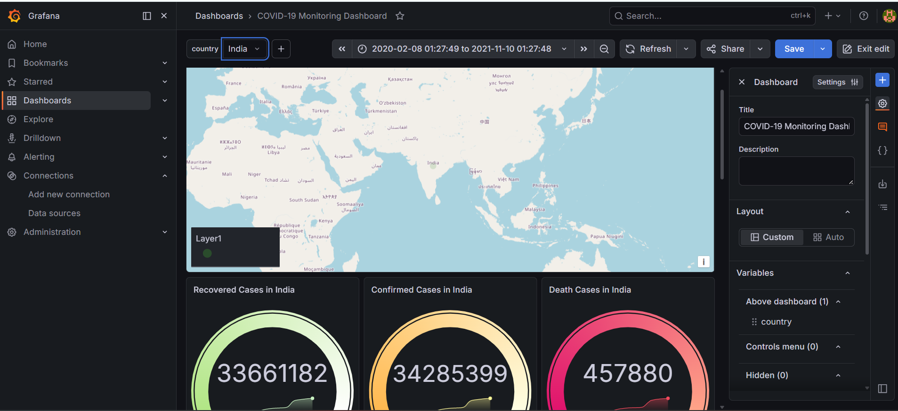
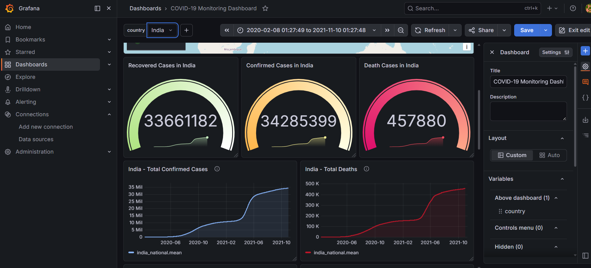

# Grafana Dashboard Documentation

## Overview

The **COVID-19 Monitoring Dashboard** is a historical data visualization project built with Grafana, InfluxDB, Python, and Docker Compose. It presents global COVID-19 trends alongside India-specific national and state-level views.

> **Data note:** This is a historical analytics dashboard, not a live COVID-19 monitoring service. Values and date ranges depend on the included datasets.

## Dashboard Features

- **Global overview:** Visualize global COVID-19 trends and compare locations using the dashboard's country selector.
- **Country filter:** The `country` variable is populated from the `location` tag in the `global_covid` measurement.
- **India national trends:** Explore the India time-series data available in the project.
- **India state comparisons:** View state-level measures, including recovered cases grouped by `State`.
- **Historical data:** Combine the Our World in Data global dataset with the project's India national and state datasets.

## Architecture

1. **CSV datasets** provide historical global, national, and state-level data.
2. **Python ingestion script** (`scripts/ingest.py`) loads data into InfluxDB.
3. **InfluxDB 1.8.10** stores the data in the `covid19` database.
4. **Grafana** queries InfluxDB using InfluxQL and renders the dashboard.
5. **Docker Compose** runs the Grafana and InfluxDB services.

The Grafana datasource is named `COVID-19 InfluxDB` and uses the internal Docker service URL `http://influxdb:8086`.

## Measurements

| Measurement | Purpose |
|---|---|
| `global_covid` | Global historical COVID-19 records, including location tags |
| `india_national` | India national-level time-series data |
| `india_state` | India state-level data, with `State` used as a tag |

The data fields include measures such as confirmed cases, recoveries, deaths, testing, and other values where provided by the source dataset.

## Import the Dashboard

The exported dashboard definition is stored at:

`grafana/dashboards/covid-19-monitoring-dashboard.json`

To import it into Grafana:

1. Start the project services using the instructions in `README.md`.
2. Open Grafana at `http://localhost:3000`.
3. Open **Dashboards** and choose **New → Import** (the wording may vary by Grafana version).
4. Upload `grafana/dashboards/covid-19-monitoring-dashboard.json`.
5. Select the `COVID-19 InfluxDB` datasource if Grafana asks you to map the datasource.
6. Complete the import and open the dashboard.

Make sure the InfluxDB service is running and the expected measurements have been populated before expecting panels to show data.

## Data Sources and Date Ranges

- **Global:** `owid-covid-data.csv` from Our World in Data; the copy in this project contains records through **2024-08-14**.
- **India national:** `case_time_series.csv`, covering **2020-01-30 to 2021-10-31**.
- **India state:** `states.csv`, covering **2020-01-30 to 2021-10-31**.

These are historical datasets. Their date ranges are not equivalent to current or real-time reporting.

## Screenshots

Screenshots are stored in the `assets/` directory. If you want to display them in this document, you can add Markdown image links using the exact filenames, for example:

```markdown



```

## Troubleshooting

- **Panels show no data:** Confirm that the CSV ingestion completed and that the expected measurements exist in the `covid19` database.
- **Datasource connection fails:** When Grafana runs in Docker Compose, use `http://influxdb:8086` as the datasource URL from inside the Compose network—not `localhost:8086`.
- **Country selector is empty:** Check that `global_covid` contains the `location` tag values used by the variable query.
- **Dashboard import asks for a datasource:** Select or configure the `COVID-19 InfluxDB` datasource and verify that it uses InfluxQL.
- **Historical panels end earlier than expected:** The India datasets end on 2021-10-31; the global dataset in this project ends on 2024-08-14.

## Related Documentation

See [`README.md`](README.md) for the project overview, setup instructions, ingestion steps, and additional project details.
