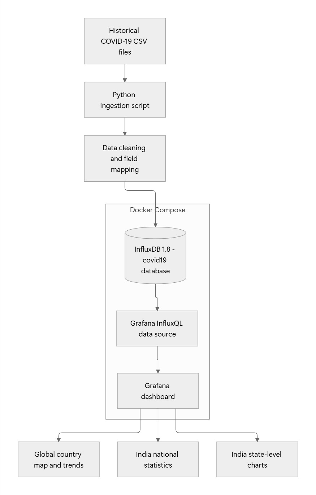
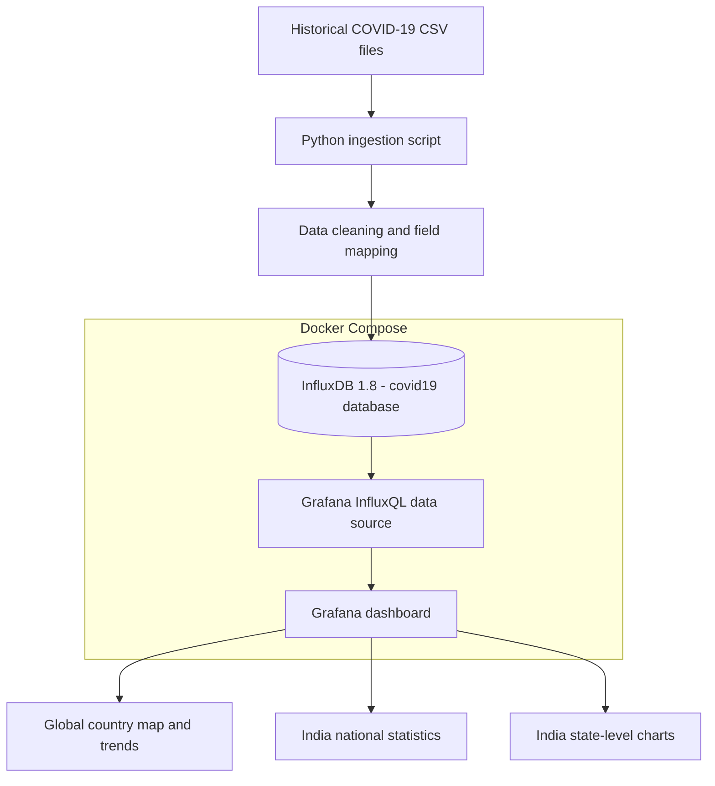
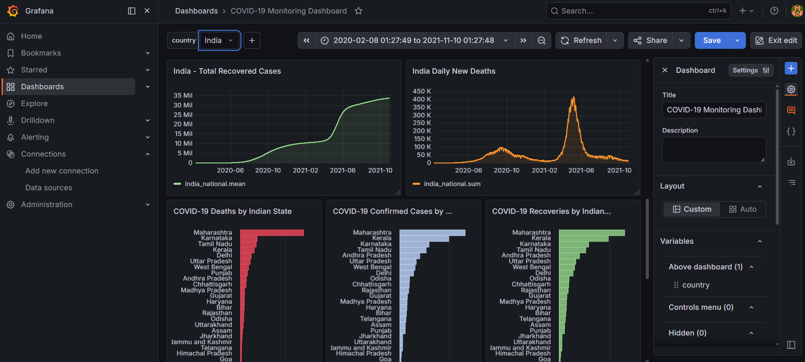
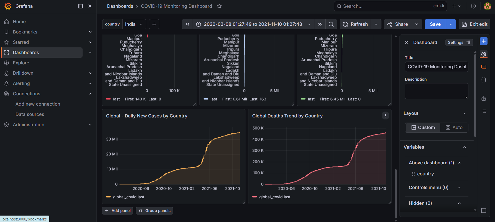

# COVID-19 Monitoring Dashboard with Grafana, InfluxDB, Python & Docker


A containerized data-visualization project that imports historical COVID-19 data into InfluxDB and displays it through an interactive Grafana dashboard. The dashboard combines global country-level information with India-focused national and state-level visualizations.

> **Data note:** This is a historical analytics and monitoring demonstration, not a real-time public-health surveillance service. The datasets used in the project are historical snapshots and may not be updated. A dashboard's displayed values depend on the selected time range, the source dataset, and the ingestion process.

---

## Table of contents

- [Overview](#overview)
- [Project objectives](#project-objectives)
- [Features](#features)
- [Architecture](#architecture)
- [Technology stack](#technology-stack)
- [Repository structure](#repository-structure)
- [Data sources and coverage](#data-sources-and-coverage)
- [Data pipeline](#data-pipeline)
- [Prerequisites](#prerequisites)
- [Installation and setup](#installation-and-setup)
- [Configure InfluxDB and Grafana](#configure-influxdb-and-grafana)
- [Run the data ingestion script](#run-the-data-ingestion-script)
- [Configure the Grafana dashboard](#configure-the-grafana-dashboard)
- [InfluxQL query examples](#influxql-query-examples)
- [Using the dashboard](#using-the-dashboard)
- [Validation and testing](#validation-and-testing)
- [Troubleshooting](#troubleshooting)
- [Security considerations](#security-considerations)
- [Data quality and limitations](#data-quality-and-limitations)
- [Potential improvements](#potential-improvements)
- [DevOps skills demonstrated](#devops-skills-demonstrated)
- [Learning outcomes](#learning-outcomes)
- [References and attribution](#references-and-attribution)
- [License](#license)

---

## Overview

The COVID-19 Monitoring Dashboard demonstrates an end-to-end data pipeline:

1. Historical COVID-19 CSV files are stored locally.
2. A Python ingestion script reads and prepares the data.
3. The script writes time-series points to InfluxDB.
4. Grafana connects to InfluxDB through an InfluxQL data source.
5. Dashboard panels visualize country-level trends, India statistics, and geographic information.
6. Docker Compose runs the Grafana and InfluxDB services in separate containers.

The project is intended as a learning and portfolio project for time-series databases, data ingestion, containerization, dashboard development, and basic DevOps workflows.

## Project objectives

- Build a reproducible local analytics environment with Docker Compose.
- Import historical COVID-19 records from CSV files using Python.
- Store time-series observations in InfluxDB.
- Build Grafana panels using InfluxQL.
- Visualize global country data using a country selector and geomap.
- Compare national trends and state-level statistics for India.
- Practice troubleshooting data, queries, dashboards, and container connectivity.

## Features

### Global analytics
- Interactive country dropdown variable.
- World geomap with country lookup/marker visualization.
- Country-filtered global time-series panels.
- Global case and death trend exploration, subject to the fields available in the imported dataset.

### India analytics
- India national confirmed-case trend.
- India national death trend.
- India national recovery trend.
- Gauge panels for national totals, where configured.
- State-level confirmed cases, deaths, and recoveries, where configured.
- Daily case/death trend panels, where configured.

### Infrastructure and data pipeline
- Docker Compose-managed Grafana and InfluxDB containers.
- Persistent Docker volumes for database and Grafana data.
- Python virtual environment for dependencies.
- CSV-based ingestion pipeline.
- InfluxQL queries for time-series panels.

> Panel names and the exact set of visualizations may vary with the saved dashboard version. Keep this README aligned with the panels and queries that are actually present in your repository.

---

## Architecture

The following diagram shows the project flow from historical CSV files through Python ingestion and InfluxDB to the Grafana dashboard and its visualizations.



<details>
<summary>View the architecture as Mermaid source</summary>



</details>

## Technology stack

| Technology | Use in this project |
|---|---|
| Docker | Runs services in isolated containers. |
| Docker Compose | Defines the multi-container environment. |
| InfluxDB 1.8 | Time-series storage and InfluxQL queries. |
| Grafana OSS | Dashboard creation and visualization. |
| Python | Data ingestion and transformation. |
| pandas | CSV reading and data preparation. |
| `influxdb` Python client | Writes points to InfluxDB. |
| CSV | Historical source data format. |
| InfluxQL | Query language used by the InfluxDB 1.x data source. |

The current setup uses InfluxDB **1.8.x** and InfluxQL. Commands and configuration for InfluxDB 2.x/3.x are not interchangeable with this setup without changes.

---

## Repository structure

The following is the expected structure based on the project setup. Confirm it against the actual files in your local repository before publishing.

```text
grafana-covid-dashboard/
├── data/
│   ├── case_time_series.csv
│   ├── states.csv
│   └── owid-covid-data.csv
├── assets/
│   ├── project-architecture.jpg
│   ├── dashboard-overview.png
│   ├── india-trends-and-states.png
│   ├── india-gauges-and-trends.png
│   ├── global-map-and-gauges.png
│   └── dashboard-global-trends.png
├── scripts/
│   └── ingest.py
├── docker-compose.yml
├── requirements.txt
└── README.md
```

### File descriptions

| Path | Purpose |
|---|---|
| `data/case_time_series.csv` | Historical India national case time series. |
| `data/states.csv` | Historical India state/region-level data. |
| `data/owid-covid-data.csv` | Our World in Data historical country-level dataset. |
| `scripts/ingest.py` | Python script that imports the prepared datasets into InfluxDB. |
| `requirements.txt` | Python package dependencies. |
| `docker-compose.yml` | Docker Compose service and volume definitions. |
| `README.md` | Project documentation and setup guide. |

**Do not commit `.venv/`, large raw datasets, credentials, or local environment files by default.** If the datasets are too large or their terms make redistribution inappropriate, provide download instructions and keep the data directory out of version control.

---

## Data sources and coverage

This project uses historical data from multiple sources.

| Dataset | Purpose | Recorded coverage in this project |
|---|---|---|
| `case_time_series.csv` | India national daily and cumulative statistics | 2020-01-30 to 2021-10-31 |
| `states.csv` | India state/region-level statistics | 2020-01-30 to 2021-10-31 |
| `owid-covid-data.csv` | Global country-level COVID-19 statistics | Records in the local copy extend through 2024-08-14 |

Coverage above describes the local copies previously used for this project; it does not imply the sources currently publish new records at those dates or beyond.

### Source links

- **Our World in Data — COVID-19 dataset:** https://github.com/owid/covid-19-data
- **Johns Hopkins University CSSE COVID-19 data archive:** https://github.com/CSSEGISandData/COVID-19

The project has used an OWID CSV for global analytics and separate historical files for India national and state statistics. Dataset formats, column names, availability, and licensing may change over time. Review each source's documentation and license before redistributing its data.

### Historical data versus live data

The dashboard is not automatically connected to a live COVID-19 API. Downloading a newer CSV does not update the dashboard by itself; the ingestion pipeline must be run again, and the dashboard must query the newly ingested records.

---

## Data pipeline

The ingestion script loads the CSV datasets and writes time-series points to the `covid19` InfluxDB database.

### InfluxDB database and measurements

Database:

```text
covid19
```

Measurements used by the project:

| Measurement | Intended contents |
|---|---|
| `global_covid` | Country-level historical statistics from OWID. |
| `india_national` | India national daily and cumulative statistics. |
| `india_state` | India state/region-level statistics. |

Fields and tags depend on the ingestion script's mapping. The global measurement has been queried using fields such as `confirmed`, `daily_confirmed`, `deaths`, `daily_deaths`, and `population`, with `location` used as a country tag. Verify exact field names against the local script and database before adding new queries.

### How InfluxDB organizes the data

- **Measurement:** Similar to a logical table, such as `global_covid`.
- **Tag:** Indexed metadata used for filtering/grouping, such as `location`.
- **Field:** A measured value, such as `confirmed` or `deaths`.
- **Timestamp:** The date/time associated with a point.

A country name may be a tag value, not a field. This distinction matters when writing InfluxQL filters.

---

## Prerequisites

Install the following on Windows:

1. **Docker Desktop** with Docker Compose support.
2. **Python** compatible with the project's dependencies.
3. **Git** if you intend to publish the repository to GitHub.
4. A web browser.

Verify the installations in PowerShell:

```powershell
docker --version
docker compose version
python --version
git --version
```

Start Docker Desktop and wait until the Docker engine is running before continuing.

> The project was previously run in a Python 3.15 virtual environment. If a dependency does not yet support your installed Python version, use a Python version supported by that dependency rather than assuming every package works with every Python release.

---

## Installation and setup

### 1. Open the project directory

The local project directory used during development was:

```powershell
cd C:\Users\javeed\grafana-covid-dashboard
```

If you cloned the repository from GitHub, change into the directory created by `git clone` instead.

### 2. Create and activate a virtual environment

```powershell
python -m venv .venv
.\.venv\Scripts\Activate.ps1
```

If PowerShell blocks activation because of the execution policy, do not change system-wide security settings blindly. You can invoke the environment's Python directly:

```powershell
.\.venv\Scripts\python.exe -m pip install --upgrade pip
```

### 3. Install Python dependencies

With the virtual environment activated:

```powershell
python -m pip install --upgrade pip
pip install -r requirements.txt
```

The project's dependency file has included `pandas` and `influxdb==5.3.2`. Check the actual `requirements.txt` if it differs.

### 4. Verify the project files

Confirm the files required by your ingestion script are present:

```powershell
Get-ChildItem
Get-ChildItem .\data
Get-ChildItem .\scripts
```

Expected data filenames in the current setup are:

```text
data\case_time_series.csv
data\states.csv
data\owid-covid-data.csv
```

If a filename or path differs, update the ingestion script or place the file at the path expected by the script. Do not assume a file downloaded from a source has the same name or schema as an older copy.

---

## Start Docker Compose

From the project root, start the services:

```powershell
docker compose up -d
```

Check the service status:

```powershell
docker compose ps
```

The development environment uses these containers and ports:

| Service | Container name | Local address |
|---|---|---|
| Grafana | `covid-grafana` | http://localhost:3000 |
| InfluxDB 1.8 | `covid-influxdb` | http://localhost:8086 |

The Compose configuration maps the services to localhost, using port `3000` for Grafana and port `8086` for InfluxDB. The intended local bindings are restricted to `127.0.0.1` so the services are not exposed on every network interface.

### Check container logs

```powershell
docker compose logs --tail 100
```

To inspect one service:

```powershell
docker logs covid-grafana --tail 100
docker logs covid-influxdb --tail 100
```

If your Compose service names or container names differ, use the names returned by `docker compose ps`.

---

## Configure InfluxDB and Grafana

### 1. Confirm InfluxDB is reachable

Open:

http://localhost:8086

For this local InfluxDB 1.8 setup, the database is named `covid19`. Authentication was disabled in the original local configuration, so do not expose this configuration to a public network.

### 2. Open Grafana

Navigate to:

http://localhost:3000

Sign in with the credentials configured for your Grafana container. If you changed the default credentials during setup, use your configured credentials; do not put passwords in this README or in Git.

### 3. Configure the data source

Create or verify the InfluxDB data source with the following settings:

| Setting | Value |
|---|---|
| Data source type | InfluxDB |
| Query language | InfluxQL |
| URL | `http://influxdb:8086` |
| Database | `covid19` |
| User/password | Blank if using the original unauthenticated local setup |

**Important:** Within a Docker Compose network, Grafana should use the InfluxDB service name, such as `http://influxdb:8086`, rather than `http://localhost:8086`. Inside the Grafana container, `localhost` refers to the Grafana container itself.

Click **Save & test**. Continue only after Grafana reports that the data source is working.

---

## Run the data ingestion script

After the containers are running and the Python dependencies are installed, run the ingestion script from the project root:

```powershell
python .\scripts\ingest.py
```

If the virtual environment is not activated, use:

```powershell
.\.venv\Scripts\python.exe .\scripts\ingest.py
```

The script is responsible for reading the CSV files, converting dates and numeric fields, and writing points to the configured InfluxDB database. Its exact behavior—including batching, duplicate handling, field mappings, and error handling—is defined by `scripts/ingest.py`.

### Verify the measurements

If the InfluxDB CLI is available in the container, you can inspect the database:

```powershell
docker exec -it covid-influxdb influx -database covid19 -execute "SHOW MEASUREMENTS"
```

Expected measurement names include:

```text
global_covid
india_national
india_state
```

Inspect the global measurement's schema:

```powershell
docker exec -it covid-influxdb influx -database covid19 -execute "SHOW FIELD KEYS FROM global_covid"
docker exec -it covid-influxdb influx -database covid19 -execute "SHOW TAG KEYS FROM global_covid"
```

Check the available country names:

```powershell
docker exec -it covid-influxdb influx -database covid19 -execute "SHOW TAG VALUES FROM global_covid WITH KEY = location"
```

If the CLI command fails, check that the container is running and that the image includes the InfluxDB CLI. You can run equivalent queries through an available InfluxQL client.

---

## Configure the Grafana dashboard

The current dashboard is named **COVID-19 Monitoring Dashboard**.

### Country variable

The dashboard uses a Grafana variable whose internal name is:

```text
country
```

Its display label may be `country` or `Country`, depending on the saved dashboard configuration.

A query used to populate the variable is:

```sql
SHOW TAG VALUES FROM "global_covid" WITH KEY = "location"
```

The query returns available `location` tag values. In the dashboard, selecting a country filters panels that use the `$country` variable.

### Global geomap

The global geomap uses the `location` tag to look up country locations. The panel was configured with a marker layer, a country lookup field, and a countries gazetteer.

A query used to retrieve the latest cumulative confirmed value for each matching country is:

```sql
SELECT LAST("confirmed")
FROM "global_covid"
WHERE $timeFilter
  AND "location" =~ /^${country:regex}$/
GROUP BY "location"
```

The exact panel query may differ depending on the final saved configuration. The variable name is case-sensitive in the query, so use the internal name `country` consistently.

### India panels

The India-specific panels use the `india_national` and `india_state` measurements. They should remain India-focused when the global country selector changes unless they have explicitly been configured to use that variable.

### Save the dashboard

After changing panels, queries, variables, or layout:

1. Click **Apply** when editing a panel.
2. Return to the dashboard.
3. Click **Save**.
4. Confirm the save dialog if prompted.
5. Refresh the dashboard and verify that the layout and query results remain correct.

---

## InfluxQL query examples

These examples are based on the field names used by the current ingestion setup. They assume the fields exist in the measurement and the selected time range contains data.

### 1. List measurements

```sql
SHOW MEASUREMENTS
```

### 2. List fields in the global measurement

```sql
SHOW FIELD KEYS FROM "global_covid"
```

### 3. List available country values

```sql
SHOW TAG VALUES FROM "global_covid" WITH KEY = "location"
```

### 4. Latest cumulative confirmed cases for a selected country

```sql
SELECT LAST("confirmed")
FROM "global_covid"
WHERE $timeFilter
  AND "location" =~ /^${country:regex}$/
GROUP BY "location"
```

### 5. Cumulative confirmed-case trend for a selected country

```sql
SELECT MEAN("confirmed")
FROM "global_covid"
WHERE $timeFilter
  AND "location" =~ /^${country:regex}$/
GROUP BY time(1d) fill(null)
```

This aggregates the cumulative confirmed value into daily buckets; it is **not** the number of new cases per day.

### 6. Cumulative deaths trend for a selected country

```sql
SELECT MEAN("deaths")
FROM "global_covid"
WHERE $timeFilter
  AND "location" =~ /^${country:regex}$/
GROUP BY time(1d) fill(null)
```

This assumes `deaths` stores cumulative deaths. If your field mapping differs, inspect `SHOW FIELD KEYS` and use the actual field name.

### 7. Daily new confirmed cases

```sql
SELECT SUM("daily_confirmed")
FROM "global_covid"
WHERE $timeFilter
  AND "location" =~ /^${country:regex}$/
GROUP BY time(1d) fill(null)
```

### 8. Daily new deaths

```sql
SELECT SUM("daily_deaths")
FROM "global_covid"
WHERE $timeFilter
  AND "location" =~ /^${country:regex}$/
GROUP BY time(1d) fill(null)
```

The daily examples assume the ingestion script stores daily values in those fields. If the script uses a different field name or aggregation method, adjust the query to match the schema.

### 9. India state-level confirmed totals

```sql
SELECT LAST("confirmed")
FROM "india_state"
WHERE $timeFilter
GROUP BY "State"
```

This assumes the state tag is named `State` and the field is named `confirmed`. If your schema uses a different tag spelling or capitalization, use the exact names returned by the schema inspection queries.

### Important query notes

- InfluxQL field and tag names must match the stored schema.
- `LAST()` returns the latest value in the selected time range.
- `MEAN()` calculates an average; it does not convert cumulative totals into daily new values.
- `SUM()` is appropriate for summing daily values when the stored series and sampling semantics support it.
- `$timeFilter` uses Grafana's dashboard time range.
- A query can return no data if the selected date range excludes the stored points.
- Grafana's **Format as** should match the visualization, such as **Time series** for trend charts.

---

## Using the dashboard

### Choose a country

1. Open the dashboard.
2. Use the country dropdown near the top.
3. Select a country, such as India or Australia.
4. Wait for Grafana to refresh the relevant panels.

The global panels and geomap should respond to the country variable if their queries use `$country`. India-only panels should continue to show India data.

### Change the time range

Use the time picker at the top of Grafana. The India datasets in this project cover approximately 2020-01-30 through 2021-10-31. The local OWID copy extends further, through 2024-08-14.

For comparisons, choose a range that overlaps the data for the panel being inspected. A dashboard time range can affect every panel that uses `$timeFilter`.

### Refresh

Use the dashboard **Refresh** control to rerun queries. Refreshing does not download newer source data or rerun the Python ingestion script.

### Read the visualizations correctly

- **Cumulative cases/deaths:** usually rise over time because they represent totals to date.
- **Daily new cases/deaths:** fluctuate because they represent new reported values per time interval.
- **Gauge panels:** show a single value based on their query and selected time range.
- **State bar charts:** compare the returned state/region values. Confirm that the query returns one appropriate latest value per state.

---

## Dashboard screenshots

The screenshots below show the dashboard in sequence, from the global overview to India-specific metrics and global trends. The images are stored in the repository's `assets/` folder so GitHub can render them directly.

### 1. Dashboard overview


### 2. India trends and state-level statistics


### 3. India gauges and trends



### 4. Global map and India gauges


### 5. Global case and death trends



## Validation and testing

Use this checklist after setting up the project.

### Infrastructure checks

- [ ] Docker Desktop is running.
- [ ] `docker compose ps` shows Grafana and InfluxDB as running.
- [ ] Grafana opens at `http://localhost:3000`.
- [ ] InfluxDB is reachable from Grafana through the Compose service address.
- [ ] The Grafana data source passes **Save & test**.

### Data checks

- [ ] The `covid19` database exists.
- [ ] The `global_covid`, `india_national`, and `india_state` measurements exist.
- [ ] The global measurement contains the expected `location` tag.
- [ ] The fields referenced by the dashboard queries exist.
- [ ] The selected time range overlaps the imported records.

### Dashboard checks

- [ ] The global geomap renders.
- [ ] The country dropdown lists available locations.
- [ ] Changing the country updates country-filtered panels.
- [ ] India-specific panels show India data.
- [ ] Cumulative and daily values are labeled accurately.
- [ ] The saved dashboard retains its layout after refresh.

---

## Troubleshooting

### Grafana says “No data”

1. Check the dashboard time range.
2. Verify that the measurement exists.
3. Inspect the schema:

   ```sql
   SHOW FIELD KEYS FROM "global_covid"
   SHOW TAG KEYS FROM "global_covid"
   ```

4. Run a simple query without the country variable:

   ```sql
   SELECT LAST("confirmed")
   FROM "global_covid"
   WHERE $timeFilter
   ```

5. If that works, test the country filter:

   ```sql
   SELECT LAST("confirmed")
   FROM "global_covid"
   WHERE $timeFilter
     AND "location" = 'India'
   ```

6. Finally, test the variable expression:

   ```sql
   SELECT LAST("confirmed")
   FROM "global_covid"
   WHERE $timeFilter
     AND "location" =~ /^${country:regex}$/
   GROUP BY "location"
   ```

Use the actual field names returned by the database. Do not assume a field called `total_deaths` exists just because that name appears in the source CSV.

### The country dropdown is empty

- Check that the variable query uses the correct measurement and tag.
- Confirm the ingestion script imported the global data.
- Run:

  ```sql
  SHOW TAG VALUES FROM "global_covid" WITH KEY = "location"
  ```

- Confirm that the variable's internal name matches the name used in panel queries.

### The map appears but has no markers

- Confirm the query returns rows in Grafana Explore.
- Check that the query includes a country/location identifier.
- Verify the geomap's lookup field matches the returned country column or tag.
- Check that the gazetteer is set to countries and that the returned names match the lookup data.
- Test one known country before debugging all locations.

### Grafana cannot connect to InfluxDB

- Confirm both containers are running.
- Use the Compose service hostname, such as `http://influxdb:8086`, inside Grafana.
- Confirm the database name is `covid19`.
- Review container logs.
- Do not use the host's `localhost` address as the Grafana container's InfluxDB hostname.

### Python cannot import `influxdb` or `pandas`

Activate the project's virtual environment and install requirements:

```powershell
.\.venv\Scripts\Activate.ps1
python -m pip install -r requirements.txt
```

If a package fails to install, inspect the Python version and the package's compatibility requirements.

### Data ingestion fails

- Confirm the CSV paths and filenames.
- Check whether column names match what `scripts/ingest.py` expects.
- Inspect date parsing and missing values.
- Confirm InfluxDB is running and the script points to the correct host and database.
- Review the exception printed by Python before retrying.
- Be careful when rerunning ingestion: duplicate handling depends on the script's timestamp, tags, and write behavior.

### Docker containers restart or data disappears

- Inspect `docker compose ps` and container logs.
- Confirm persistent volumes are declared and mounted in `docker-compose.yml`.
- Do not run `docker compose down -v` unless you intentionally want to delete the Compose-managed volumes and understand that this can remove stored data.

---

## Security considerations

This project was developed as a local learning environment. Before sharing or deploying it:

- Keep Grafana and InfluxDB bound to localhost unless remote access is explicitly required.
- Enable authentication and appropriate access controls before exposing either service to a network.
- Use strong credentials and store secrets outside source control.
- Do not commit passwords, tokens, private environment files, or database exports containing sensitive information.
- Review Docker port mappings and firewall rules.
- Use supported, patched versions and plan upgrades carefully.
- Avoid publishing raw datasets unless their license and redistribution terms permit it.
- Never use the dashboard as a clinical, emergency-response, or official public-health decision system.

---

## Data quality and limitations

- **Historical data:** The local files represent past reporting periods; this is not a live feed.
- **Different sources:** Global, India national, and India state data may use different reporting definitions, update schedules, and aggregation methods.
- **Reporting revisions:** Historical COVID-19 data may be revised, corrected, or backfilled.
- **Missing values:** A blank value is not necessarily zero. The treatment of missing values depends on the ingestion script and Grafana query.
- **Cumulative versus daily fields:** Cumulative values must not be presented as daily new cases or deaths.
- **Time range:** Panels using Grafana's `$timeFilter` can return no data when the selected period does not overlap the dataset.
- **State aggregation:** State-level totals should not automatically be added to national totals unless the records and reporting definitions have been checked for double counting.
- **Location lookup:** Country-name differences can prevent some points from appearing on the geomap.
- **Schema differences:** The exact stored field and tag names depend on the transformation performed by `scripts/ingest.py`.

---

## Potential improvements

These are future enhancements, not claims about features already implemented.

1. **Reproducible provisioning:** Provision the Grafana data source and dashboard from version-controlled configuration files.
2. **Automated ingestion:** Add a scheduled ingestion workflow with clear logging, retry behavior, and duplicate-safe writes.
3. **Data validation:** Validate input columns, timestamps, null values, and record counts before ingestion.
4. **Automated tests:** Add tests for data transformations and expected measurement/tag/field names.
5. **CI pipeline:** Use GitHub Actions to run linting and tests on each pull request.
6. **Operational visibility:** Add health checks, container restart policies, and documented recovery steps.
7. **Security hardening:** Enable authentication, manage secrets safely, and document network exposure.
8. **Reproducible versions:** Pin dependencies and document tested Python, Docker, Grafana, and InfluxDB versions.
9. **Dashboard export:** Export the finished dashboard JSON and store it in a `grafana/` directory, after removing sensitive values.
10. **Deployment:** If moving beyond local development, use a suitable secured deployment environment with persistent storage, backups, and access controls.

---

## DevOps skills demonstrated

This project can demonstrate the following skills in a portfolio or technical discussion:

- Containerizing and running multiple services with Docker Compose.
- Configuring service-to-service networking.
- Managing persistent container volumes.
- Building a Python-based ingestion pipeline.
- Working with time-series databases and InfluxQL.
- Configuring Grafana data sources, variables, panels, and geomaps.
- Debugging schema mismatches, time filters, and empty query results.
- Documenting reproducible setup and operational troubleshooting.
- Understanding basic security and data-quality considerations.

Do not list automated CI/CD, cloud deployment, alerting, production monitoring, or orchestration as completed features unless you implement and verify them.

---

## Learning outcomes

After completing the project, you should be able to explain:

1. How CSV data is transformed into time-series records.
2. How InfluxDB measurements, tags, fields, and timestamps work.
3. Why Grafana uses a container service hostname to connect to InfluxDB.
4. How InfluxQL queries filter and aggregate time-series data.
5. How dashboard variables make panels interactive.
6. How time ranges affect the data returned by a query.
7. How to troubleshoot missing data by checking the database schema and simplifying the query.
8. How Docker volumes preserve data independently of container lifecycle.
9. Why historical analytics should not be described as real-time monitoring.
10. How to document, test, and version-control a data visualization project.

---

## References and attribution

- Our World in Data, COVID-19 dataset: https://github.com/owid/covid-19-data
- Johns Hopkins University CSSE COVID-19 data archive: https://github.com/CSSEGISandData/COVID-19
- Grafana documentation: https://grafana.com/docs/grafana/latest/
- InfluxDB 1.8 documentation: https://docs.influxdata.com/influxdb/v1/
- Docker Compose documentation: https://docs.docker.com/compose/
- pandas documentation: https://pandas.pydata.org/docs/
- Python documentation: https://docs.python.org/3/

Please retain the attribution and licensing notices required by the source datasets. Confirm the specific terms for the exact files you downloaded before redistributing them.

---

## License

No license has been specified for this project yet. Add a `LICENSE` file before presenting the repository as open source. Choose a license that matches your intended use and make sure it is compatible with the rights and terms of the datasets included or referenced.

---

## Author

**Project:** COVID-19 Monitoring Dashboard  
**Focus areas:** Python · Docker Compose · InfluxDB · Grafana · Time-series analytics · Data visualization

**Name:** Javeed Mangalore  
**GitHub:** [JaveedMangaloregd](https://github.com/JaveedMangaloregd)
